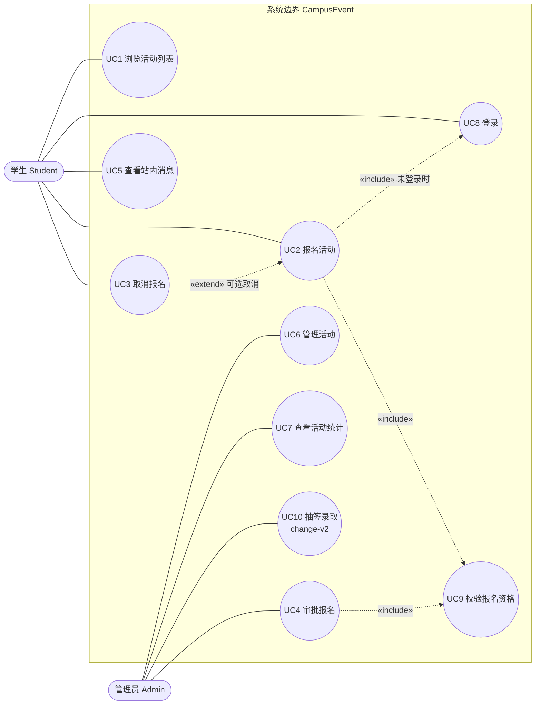

# 02 用例模型

## 1 用例图

- **UC9 校验报名资格**是 include：报名和审批两条路径**必然**执行名额/重复/状态校验，脱离它用例不完整。
- **UC3 是 extend**：取消是报名之后的**可选**行为，基础用例（报名）不依赖它才完整。这是最容易画错的地方——按"是否可选"判断的话，取消确实可选，但取消并不"插入"报名的流程，所以更准确的关系其实是两个独立用例；本项目保留 extend 标注是为了体现"取消依附于已存在的报名"这一前置条件。

## 2 用例规格：UC2 报名活动

| 项 | 内容 |
|---|---|
| 用例编号 | UC2 |
| 参与者 | 学生（主）、管理员（间接，审核型活动需要） |
| 前置条件 | 活动存在且处于开放状态、开始时间晚于当前时间 |
| 触发 | 学生在活动详情页点击"立即报名" |
| 主成功场景 | 1. 学生提交报名请求；2. 系统校验资格（活动存在/未关闭/未开始/无重复有效报名/名额未满）；3. 系统按 `policy_type` 取策略；4. 直接报名→置"已通过"，审核型→置"待审核"；5. 事务提交；6. 发布报名事件，写站内消息；7. 返回结果并刷新页面 |
| 扩展流 | A-1 未登录 → 跳转登录页，登录后回到原活动；A-2 活动已开始 → `ACTIVITY_STARTED`；A-3 名额已满 → `CAPACITY_FULL`；A-4 已有有效报名 → `DUPLICATE_ACTIVE`；A-5 并发重复提交 → 数据库唯一索引拦截，返回 `DUPLICATE_ACTIVE`；A-6 通知失败 → 报名仍成功，`notify_outbox` 记 `FAILED` |
| 后置条件 | 数据库存在一条报名记录；成功时学生收到一条站内消息 |
| 业务规则 | B.2-1、B.2-2、B.2-3、B.2-4 |

## 3 用例规格：UC4 审批报名

| 项 | 内容 |
|---|---|
| 用例编号 | UC4 |
| 参与者 | 管理员（主）、学生（间接，接收结果） |
| 前置条件 | 报名记录存在且状态为"待审核" |
| 触发 | 管理员在管理台点击"批准"或"拒绝" |
| 主成功场景 | 1. 管理员提交审批；2. 系统校验记录存在且为待审核；3. 批准时**再次**统计已通过人数；4. 未满 → 置"已通过"；5. 事务提交；6. 发布审批事件，写站内消息 |
| 扩展流 | A-1 名额已满 → `CAPACITY_FULL`，状态保持待审核（用例 C8）；A-2 记录已不是待审核 → `INVALID_STATE`；A-3 拒绝 → 置"已拒绝"，同样产生通知 |
| 后置条件 | 报名状态变为已通过或已拒绝；学生收到一条站内消息 |
| 业务规则 | B.2-2、B.2-3 |

## 4 用例与实现的对应

| 用例 | 服务方法 | 视图 | 测试 |
|---|---|---|---|
| UC1 浏览活动 | `ActivityRepository.list_all` | `student.index` | `test_search_filters_by_title` |
| UC2 报名 | `RegistrationService.register` | `student.register` | `test_register.py` 全部 |
| UC3 取消 | `RegistrationService.cancel` | `student.cancel` | `test_cancel.py` 全部 |
| UC4 审批 | `RegistrationService.approve/reject` | `admin.approve/reject` | `test_approve.py` 全部 |
| UC5 站内消息 | `MessageRepository` | `student.messages` | `test_messages_page_marks_messages_read` |
| UC6 管理活动 | `ActivityService` | `admin.*` | `test_admin.py` 全部 |
| UC7 统计 | `RegistrationService.statistics` | `admin.index` | `test_statistics` 相关断言 |
| UC8 登录 | `StudentRepository.authenticate` | `auth.login` | `test_login_*` |
| UC10 抽签 | `RegistrationService.draw_lottery` | `admin.draw_lottery` | `test_lottery.py` 全部 |
