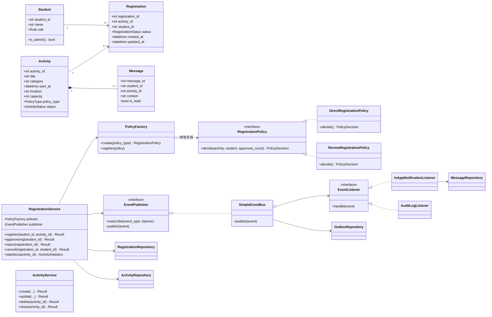
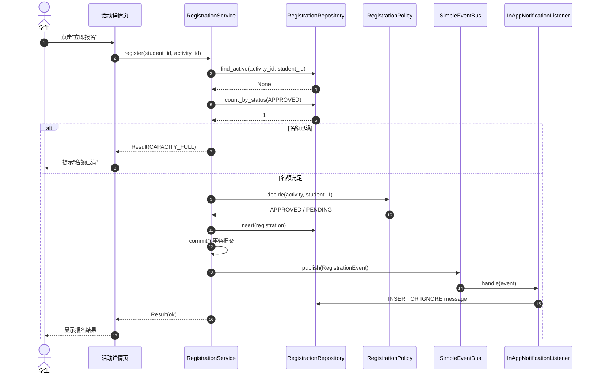
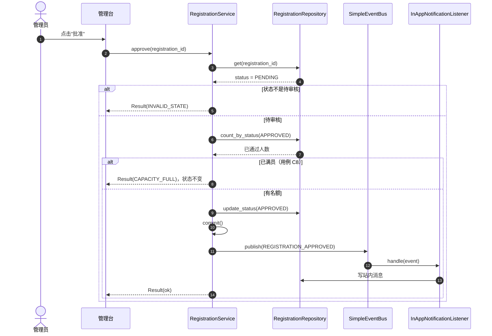

# 03 设计模型与设计决策

## 1 类图：初版（baseline-v1）



> `Registration` 上 `(activity_id, student_id)` 对 `PENDING/APPROVED` 唯一，是数据库层的部分唯一索引，类图无法表达，写在约束说明里。

## 2 类图：变更版（change-v2）新增部分

```mermaid
classDiagram
    direction LR

    class RegistrationPolicy {
      <<interface>>
      +decide(activity, student, approved_count) PolicyDecision
    }
    class LotteryRegistrationPolicy {
      <<新增>>
      +decide() PolicyDecision
    }
    class RegistrationService {
      +draw_lottery(activity_id, rng) Result
    }
    class EventListener {
      <<interface>>
      +handle(event)
    }
    class EmailNotificationListener {
      <<新增>>
      +handle(event)
    }

    RegistrationPolicy <|.. LotteryRegistrationPolicy
    EventListener <|.. EmailNotificationListener
    Note "注册进 PolicyFactory 只需一行；\n注册进事件总线只需一行订阅"
```

**变更前后对比**：三个策略实现共存于同一接口；三个监听器订阅同一批事件。`RegistrationService.register/approve/reject/cancel` **一行未改**（`git diff` 显示 services.py 只有 48 行新增、0 行删除，全部落在新方法 `draw_lottery`）。

## 3 时序图：报名（直接报名 / 审核型）



关键点：`publish` 在 `commit` **之后**。若通知写入失败，`SimpleEventBus` 捕获异常并写 `notify_outbox(FAILED)`，报名记录已经落库，不会回滚。

## 4 时序图：审批（含名额复核）



## 5 设计决策与原则

### 5.1 为什么用策略模式（而不是 if-else 判断 policy_type）

- 变化点是"报名规则"，不是"报名流程"。流程（校验→决定→落库→通知）是稳定的，规则是易变的。
- if-else 版本新增第三种规则时要修改 `RegistrationService.register()`，且每加一种规则都要重新回归全部报名用例；策略版本只新增一个类 + 工厂登记一行。
- 证据：CR-01 落地后 `register()` 的 diff 为 0 行。

### 5.2 名额检查放在服务层，不放策略里

| 判据 | 结论 |
|---|---|
| 报名与审批两条路径是否都要用 | 是 → 公共规则 |
| 是否需要数据库聚合计数（COUNT） | 是 → 属于数据层不变量 |
| 放进策略会不会重复实现 | 会，每个策略都要写一遍 → 违反 DRY/SRP |

策略只回答"这一笔申请该置为何种状态"，返回 `PolicyDecision(status, reason)`，无副作用、不碰数据库——因此策略可替换、可单测。

### 5.3 为什么用观察者模式解耦通知

- `RegistrationService` 里没有任何 `Message`、`email` 字样，它只知道"发生了事件"。
- 通知渠道从 1 个变 3 个（in_app / email / audit），业务代码改动为 0。
- 失败隔离：一个监听器抛异常不影响其它监听器，也不影响已提交的报名。

### 5.4 事务边界与幂等

| 问题 | 方案 |
|---|---|
| 通知失败要不要回滚报名 | 不回滚。事件在 commit 后发布，失败写 `notify_outbox` 留痕（B.2-6） |
| 同一事件重复投递会不会重复通知 | `message.UNIQUE(event_id, student_id)` + `INSERT OR IGNORE`；`notify_outbox.UNIQUE(event_id, listener)` |
| 并发下会不会出现两条有效报名 | 部分唯一索引 `(activity_id, student_id) WHERE status IN ('PENDING','APPROVED')` 兜底，服务层捕获 `IntegrityError` |

### 5.5 SOLID 对照

| 原则 | 体现 |
|---|---|
| SRP | 策略只管决策、服务只管不变量与编排、监听器只管通知、仓储只管 SQL |
| OCP | 新增策略/监听器是"加类"，不是"改类"（CR-01/02 已证） |
| LSP | 两个策略实现可互换，服务对 `policy_type` 无特判（`decide` 签名与语义一致） |
| ISP | `RegistrationPolicy` 只有一个方法，`EventListener` 只有一个方法 |
| DIP | 服务依赖 `EventPublisher`/`RegistrationPolicy` 抽象，不依赖具体实现 |

### 5.6 模式带来的成本（如实报告）

1. 类数量增加：策略 1 接口 + 2 实现 + 1 工厂，事件 1 接口 + 1 总线 + 2 监听器，共 9 个额外类，对 8 个功能的系统而言偏重。
2. 调用链变长：读代码要跨 `service → policy → repo → bus → listener` 五层，新人上手成本高于单文件 if-else。
3. **状态维度不可扩展**：CR-03（候补队列）需要新增 `WAITLISTED` 状态，策略模式帮不上忙——状态枚举是硬骨头。这是本次设计的真实边界，也是 06 变更分析的核心结论。
