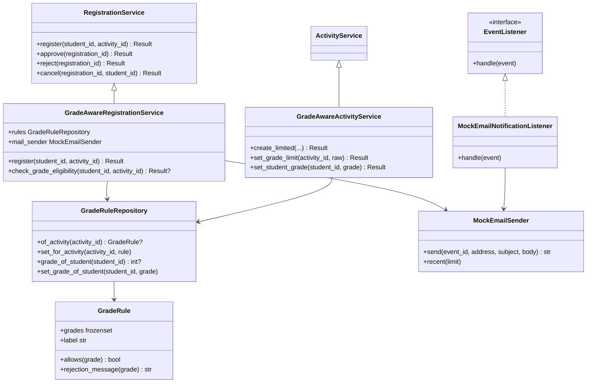
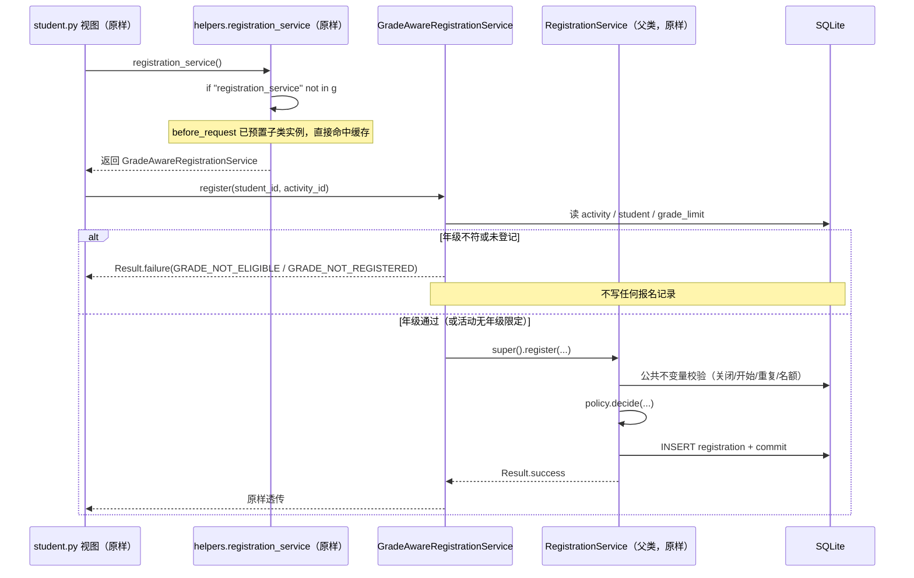
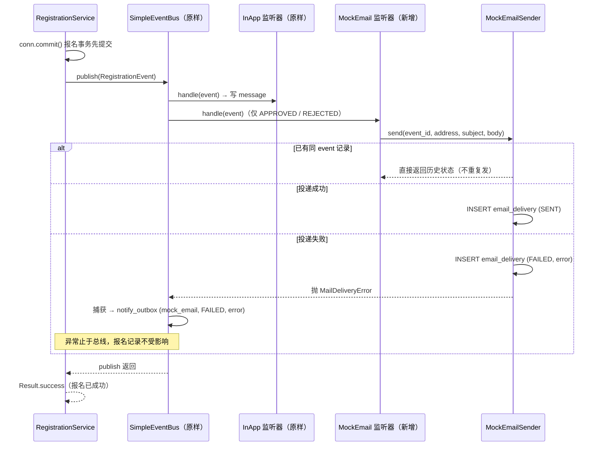

# 增量设计与开闭原则论证（v2）

> 本文档说明 CR-01 / CR-02 在"不修改原有代码"约束下如何落地，
> 并对每个设计选择给出理由与被否决的替代方案。

---

## 1. 约束与目标

| 输入 | 内容 |
|---|---|
| 硬约束 | 遵循开闭原则；增量修改；**不修改原本的代码**；只改文档、只加代码 |
| CR-01 | `Student` 增 `grade`（1—4）；`Activity` 支持"年级限定直接报名"；仅 2、3 年级可报；其他年级给明确提示；**同时遵守名额/开始时间/重复报名等公共约束**；原直接报名与审核报名行为不变 |
| CR-02 | 站内通知照旧，**新增**模拟邮件；`MockEmailSender` 记录收件人/主题/内容/状态/时间；邮件故障须记录错误但不得回滚已提交报名；同一事件不重复发送 |
| 材料明确的评分弹性 | "是否通过新增策略而不修改核心服务**不是唯一评分标准**，应结合原系统设计决定" |

---

## 2. 总体结构

```
                      ┌──────────────────────────────┐
  原有（一行未改）     │  app/                        │
                      │   models · db · repositories │
                      │   policies · events          │
                      │   services · routes · 模板    │
                      └───────────────┬──────────────┘
                                      │ 继承 / 复用 / 订阅
                      ┌───────────────┴──────────────┐
  新增（本轮）         │  ext_v2/                     │
                      │   schema_v2    加列加表       │
                      │   grade_v2     准入规则+仓储  │
                      │   email_v2     MockEmailSender│
                      │   bus_v2       扩展装配       │
                      │   services_v2  子类           │
                      │   routes_v2    /ext/admin     │
                      │   bootstrap_v2 组合根接线     │
                      └───────────────┬──────────────┘
                                      │ install(app)
                      ┌───────────────┴──────────────┐
  入口（新增）         │  app_v2.py  →  app = ...      │
                      │  （wsgi.py 保持原样）          │
                      └──────────────────────────────┘
```

**原代码零改动的机械证明**：`git diff --stat HEAD` 输出为空；`git status` 只有未跟踪的新文件。改动范围见 `docs/08-回归测试表-v2.md` §4。

---

## 3. 五个扩展点

| # | 原系统的缝隙 | 扩展手段 | 为什么安全 |
|---|---|---|---|
| E-1 | `CREATE TABLE IF NOT EXISTS` 不会动已存在的表 | `ALTER TABLE ... ADD COLUMN`（幂等） | 只加可空列，历史行取 NULL，不重建表、不改约束 |
| E-2 | `ActivityRepository._to_model` 按列名取值，忽略多余列 | 新列对原仓储**透明** | `SELECT *` 多一列不会报错；原模型类不需改 |
| E-3 | `RegistrationPolicy` 是可继承的抽象类 | 不做策略，做**正交准入规则** | 不触碰 `PolicyType` 枚举与数据库 CHECK |
| E-4 | `EventListener` 是观察者接口 | 新增订阅者 `mock_email` | 总线原有异常隔离/留痕机制直接复用 |
| E-5 | `helpers.registration_service()` 用 `g` 做请求级缓存 | `before_request` 预置子类实例 | 原判断 `if "registration_service" not in g` 自然命中，无需猴子补丁 |

---

## 4. CR-01：准入规则与报名策略正交

### 4.1 核心判断

材料给的两条路线是"新增独立策略"或"可组合规则"。本实现选**可组合规则**，因为它对准了两个不同的变化轴：

```
        报名如何录取（原系统的变化轴）        面向哪些年级（本轮新增的变化轴）
        ─────────────────────────           ────────────────────────────
        DIRECT  写入即 APPROVED             不限     任何年级
        REVIEW  写入 PENDING                限定     仅白名单年级
        LOTTERY 写入 PENDING 后抽签
                    │                                  │
                    └────────── 正交组合 ──────────────┘
                          DIRECT + 限定 = 年级限定直接报名（本轮需求）
                          REVIEW + 限定 = 年级限定审核报名
                          LOTTERY + 限定 = 年级限定抽签
```

做成策略则必须为每种组合新增一个类（类爆炸），而且**语义也不对**：`PolicyDecision` 只能表达"置为何种状态"，而"年级不符"是**不产生申请**，不是一种状态。

### 4.2 类图（本轮新增部分，虚线表示继承/复用既有类型）



### 4.3 报名时序



**关键点**：名额、开始时间、重复报名三项校验**只存在于父类**，子类没有任何旁路。所以材料"该规则同时遵守名额限制、活动开始时间和重复报名等公共约束"是结构上保证的，而不是靠代码里再抄一遍。

---

## 5. CR-02：在既有观察者链上新增一个订阅者

### 5.1 装配对比

```
变更前（wsgi:app，build_event_bus）
  SimpleEventBus
    ├─ in_app     InAppNotificationListener   → message 表
    ├─ email      EmailNotificationListener   → email_outbox（只入队，无投递）
    └─ audit      AuditLogListener            → 日志

本轮（app_v2:app，build_extended_bus）
  SimpleEventBus（同一个类，未改）
    ├─ in_app          InAppNotificationListener（原样复用）→ message 表
    ├─ mock_email      MockEmailNotificationListener（新增）→ email_delivery 表
    └─ audit           AuditLogListener（原样复用）        → 日志
```

### 5.2 事件 → 双渠道时序



**"不得回滚已提交报名"的结构性保证**：`RegistrationService._publish()` 在 `commit()` **之后**才发布事件；`SimpleEventBus.publish()` 对每个监听器 `try/except` 并只记录留痕。两条都是原代码既有行为，本轮一行未改。

### 5.3 幂等的两层

| 层 | 机制 | 覆盖的重复来源 |
|---|---|---|
| 业务层 | 原服务 `find_active` 查重 + 部分唯一索引 `ux_active_registration` | 学生重复点击提交（第二次被 `DUPLICATE_ACTIVE` 拦住，不产生事件） |
| 通知层 | `email_delivery` 上 `UNIQUE(event_id, address)` + 投递前查 | 同一事件被重复 publish（重试、补发、并发） |

---

## 6. 开闭原则自评

| 维度 | 判断 | 证据 |
|---|---|---|
| **对修改封闭** | 守住 | `git diff HEAD` 为空；`app/`、`wsgi.py`、`seed.py`、`tests/` 下原文件均未改动 |
| **对扩展开放** | 守住 | 新增规则 = 新增 `GradeRule` 使用者；新增渠道 = 新增 `EventListener` 实现；新增能力 = 新增蓝图 |
| 扩展是否需要改组合根 | 需要，但只改**新增的**组合根 `app_v2.py` | 原 `create_app()` 没有注册扩展的接口；这是原系统的设计局限，不是本轮引入的耦合 |
| 是否用了猴子补丁 | 否 | 替换点唯一且显式：`bootstrap_v2._inject_services` |
| 数据库结构是否兼容 | 是 | 只加列加表；同一份库可被 `wsgi:app` 与 `app_v2:app` 同时打开 |

**诚实的限度**：本方案并非"任何新需求都不必动代码"。若下一步要求"在原管理台表单里直接选年级"，就必须改 `admin.html` 与 `routes/admin.py` —— 那属于 UI 集成，不是规则扩展。开闭原则能保证规则层与通知层稳定，不能保证所有层都免修改。

---

## 7. 运行与验证

```bash
# 1) 装依赖（演示环境可复用已有虚拟环境）
pip install -r requirements.txt

# 2) 准备数据：原演示数据 + 年级/年级限定活动/邮件样例
python seed_ext_v2.py

# 3) 启动扩展版
python app_v2.py            # 开发
# gunicorn -w 1 --threads 4 app_v2:app   # 生产（SQLite 必须单 worker）

# 4) 验证
python -m pytest -q          # 58 passed（25 原有 + 33 新增）
python smoke_v2.py           # HTTP 链路冒烟
```

入口对照：

| 入口 | 装配 | 用途 |
|---|---|---|
| `wsgi:app` | 原样 | 变更前行为对照 |
| `app_v2:app` | 原样 + CR-01/CR-02 | 本轮交付 |
